# Building Skills Across Chat, Cowork, and Claude Code

This was the final regular session of AI Summer 2026. It is a working tour of the three places you can build a skill — Chat, Cowork, and Claude Code — and, more importantly, how to decide which one fits a given problem. Along the way it covers how skills let small, cheap models punch far above their weight; what Claude Code shows you that Cowork hides; how to keep token use under control; and how to treat a skill as a living thing you iterate on from real feedback. The session ends by sketching where this is all heading: dynamic "Agents 2.0" assembled from skills on the fly, and the harder engineering work of turning those into robust, repeatable processes.

These notes are written to stand on their own. If you missed the session, you should be able to read straight through and come away knowing the material without watching the recording. Timestamps are included on section headings and demos so you can jump to a specific moment in the video if you want to see something happen live.

## Key Concepts and Learning Objectives

**Key terms:**

- **Skill** — a packaged set of instructions (and optionally code, references, and assets) that teaches a model how to perform a task well. At minimum it is a `SKILL.md` file at the top of a folder, with supporting material underneath. Skills are cross-platform: a skill authored in Cowork can run in ChatGPT, Gemini, or even an open-source model, as long as that model is "skill-compliant" (most now are).
- **The three surfaces** — Chat, Cowork, and Claude Code. All three can create and run skills; they differ in how much context you can give, how much of the work you can see and steer, and whether you get the underlying code.
- **Claude Code (app) vs. Claude Code (CLI)** — the app runs in a managed virtual machine and can drop results into a folder you choose; the command-line version runs "bare iron" directly on your laptop, with easy access to your files and local tools.
- **Opus 4.7 / Haiku 4.5** — Opus is the most capable model but expensive and rate-limited; Haiku is fast and cheap but less knowledgeable. A key insight of the session: a well-authored skill lets Haiku perform a specific task about as well as Opus does *without* a skill.
- **OCR / context rot / data poisoning** — three reasons to convert PDFs to Markdown before feeding them to a model: PDFs may be images needing optical character recognition, they consume large amounts of context (degrading quality), and their formatting layer is a vector for hidden malicious instructions.
- **Shift-Tab modes** — in Claude Code you cycle between *plan mode* (think, don't act), *accept-edits* mode, and *auto mode* (fast-forward; do safe things automatically, ask before unsafe ones).
- **Agents 1.0 vs. Agents 2.0** — 1.0 agents have an orchestration/flow you design in advance (good for repeatable, code-like processes); 2.0 agents are dynamic and flexible, assembled from skills at the moment of the request and then discarded.
- **Goal loop (`/goal`)** — a loop that keeps drafting and testing until a clearly stated, model-judgeable goal is met.

**Learning objectives:**

1. Decide whether to build a given skill in Chat, Cowork, or Claude Code, based on context size, need for code, and how much you want to steer.
2. Use a subdirectory of curated source material to give an agent the context it needs — and explain why that beats relying on the model's own knowledge.
3. Explain why you might author a skill with Opus 4.7 but run it with Haiku 4.5, and how to test a skill across models.
4. Read what Claude Code is doing at the command line (bash commands, git operations) and use Shift-Tab to switch between plan, accept-edits, and auto modes.
5. Treat a skill as iterative: gather feedback, restate the bar, and regenerate — including reprocessing all prior outputs in minutes.
6. Recognize when work should stay an Agent 2.0 (flexible, skill-driven) versus be hardened into an Agent 1.0 (robust, repeatable), and judge what data is safe to send where.

---

## Part 1 — Before We Start: How You Actually Learn Agents (00:04:03)

A participant asked in chat for good resources to get started with Claude. Jesse's answer was deliberately circular: the best resource for learning Claude is Claude itself.

> "I'm of the old school — you read everything about a product before you start using it. I've learned whole programming languages by reading a book... But that's not actually how you learn about AI agents. You actually learn by using them." — Jesse Spencer-Smith

Claude Code in particular is built to *progressively reveal* its capabilities: as you work, it surfaces additional ways of doing things rather than expecting you to read a manual first.

There is one important caution: **don't assume a model knows about itself.** A model is trained before its own capabilities and surrounding frameworks exist, so its knowledge of "what this model can do" is often absent or wrong. If you want accurate answers about the model or a fast-moving framework, tell it to research the question rather than answer from memory.

> "Everything that we know about models, and often about frameworks, comes after that model ended its training. So if it is not doing research on itself to answer questions about itself, it won't be able to do a good job." — Jesse Spencer-Smith

(In chat, a participant joked that self-aware models would be "a HUGE deal" — the point landed: they're not as self-aware as people assume.)

---

## Part 2 — Three Surfaces for Building Skills (00:09:40)

The session's organizing question: when you want to build a skill, where should you build it? There are three surfaces, and the choice matters.

### Chat (00:10:25)

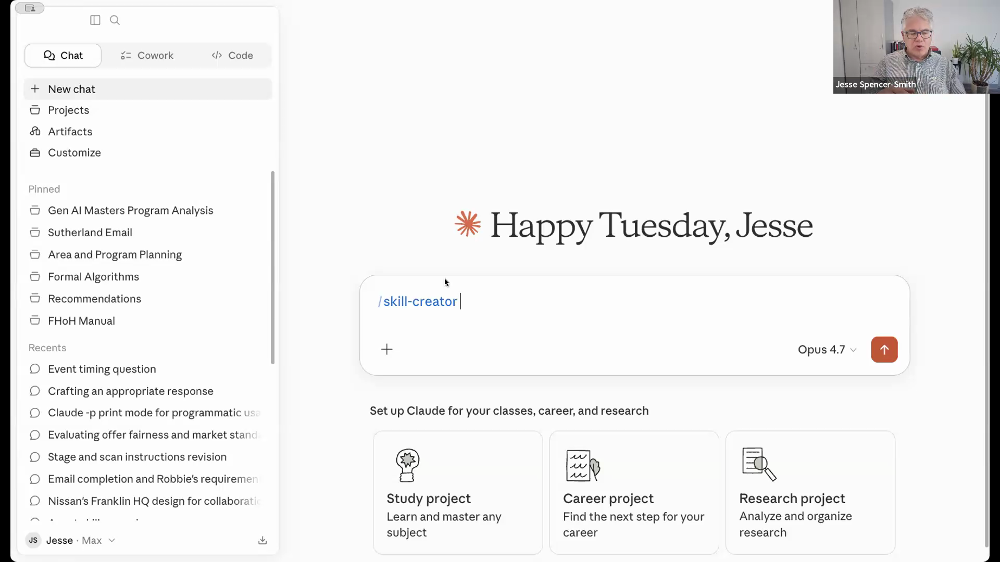

You can build a skill right in Chat by invoking the `/skill-creator` skill. It works, but it has a real limitation: you have to type all the context yourself, and there isn't much room to give the model the background it needs to write a genuinely good skill.

A practical workaround for getting context in without typing it all: have a conversation with an expert, or dictate notes to yourself using audio-to-text (the Notes app on an iPhone does this), then paste that in. The goal is to get as much relevant context in front of the model as you can.

### Cowork and the power of a subdirectory (00:12:21)

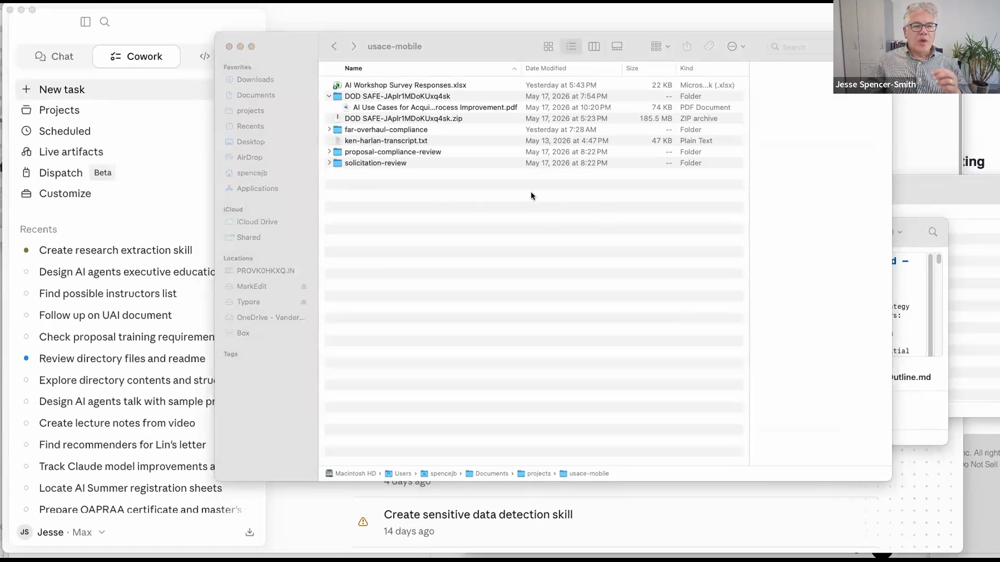

Cowork's advantage is that you can point it at a **subdirectory** on your machine — and that subdirectory can hold an enormous amount of context. Jesse's running example was a project for a presentation to the U.S. Army Corps of Engineers: the subdirectory contained roughly 1,500 pages of the Federal Acquisition Regulations (the rules governing how U.S. government acquisitions must happen) as source documents.

He doesn't know that domain himself. But because the authoritative documents are in the folder, any skill he builds with the agent pointed there can cite the specific article and page as it works. The result is far better than what Chat alone would produce:

> "Through chat, is the model going to know about Federal Acquisition? Yes. But Federal Acquisition rules changed significantly in the last few months — so it would be completely wrong. Because I've loaded what I need... it has the latest information, and I know it's the latest because I put it there." — Jesse Spencer-Smith

The lesson generalizes: **part of your job in building a custom agent is curating the information the agent will need.** Collect the authoritative material, drop it in the folder, and the agent becomes knowledgeable and targeted for exactly your task.

A few clarifications from the discussion and chat:

- **Skills work without a Pro account.** You need Pro for Cowork and Claude Code, but a skill is just a Markdown file, and a free Claude account can *use* a skill in Chat. That makes skills a clean way to hand students packaged assignments and background resources.
- **Skills are cross-platform.** Create one in Cowork and use it in ChatGPT, Gemini, or open-source models. (Vanderbilt's Amplify is the exception — it doesn't appear to support skills yet; "MAJK"/Magic does.)
- **Subdirectories must be local.** You can point Cowork at a OneDrive or SharePoint folder, but it has to be synced to your machine — on OneDrive, set the folder to "Keep on Device."

---

## Part 3 — Models and Skills: Why Haiku Can Stand In for Opus (00:18:15)

A participant noticed that when creating a skill in Cowork, it suggested using Haiku instead of Opus, and asked why.

The trade-off: **Haiku 4.5** is fastest and cheapest but less knowledgeable about the world; **Opus 4.7** is the most capable but expensive and rate-limited. The key insight is that a good skill changes the equation:

> "Haiku 4.5 — simple, old, tiny Haiku 4.5 — given a skill, can perform at the level of Opus 4.7 without skills. Haiku really knows how to use skills." — Jesse Spencer-Smith

So a sensible pattern is: **author the skill with Opus 4.7** (best quality during creation), then **run it with Haiku 4.5** (cheap and fast, because the skill carries the process knowledge). Opus *with* skills sits near the ceiling and is hard to beat, but Haiku-with-a-good-skill gets you very good performance for a fraction of the cost.

Two practical notes:

- **Force the skill-creator skill.** Opus 4.7 has had some additional training and, oddly, is now *less* likely to invoke the skill-creator skill on its own — meaning it may try to write a skill from its own knowledge, which is worse. Start your request by typing `/skill-creator` explicitly so the model follows best practices.
- **Test where you'll run.** If you plan to run a skill in Haiku, switch to Haiku and test it there.

### Benchmarking a skill across models (00:22:23)

Asked how to assess whether a smaller model is good enough, Jesse outlined the approach. The skill-creator already generates test cases and runs each task three times with the skill and three times without — but always on the *same* model. To compare across models:

- The best way: ask it to make a test case **reproducible**, so you can rerun the identical test after changing the model. That gives you a true head-to-head (Opus vs. Haiku).
- A lighter approach: brainstorm with Opus 4.7 to design the test, and even build a second "scoring" skill — so you *test* the skill in Haiku 4.5 but *score* the results in Opus 4.7.

---

## Part 4 — Claude Code: A Front-Row Seat (00:24:34)

Once you can build a skill in Cowork, when should you reach for Claude Code? Jesse compared Claude Code in the app to Claude Code on the command line.

**The app** runs in a virtual machine in a special location and can move results down into a folder you select. **The command line is "bare iron"** — it runs directly on your laptop with easy access to everything you give it permission to touch.

> "Think of Claude Code as a front-row seat to everything that's happening. In Cowork, it's hidden — it's happening behind the scenes." — Jesse Spencer-Smith

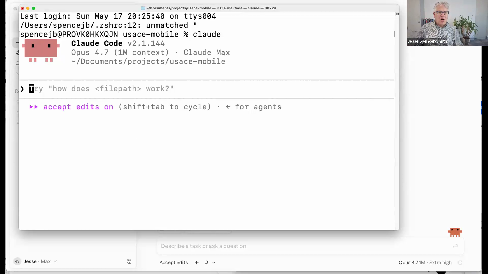

To start Claude Code at the command line on a Mac: right-click a folder in Finder, choose "New Terminal at Folder," then type `claude`. It reports the model in use (here, Opus 4.7 with a 1M-token context), the plan, the working directory, and a hint — part of that progressive reveal — that you can press **Shift-Tab to cycle** modes.

### Shift-Tab modes (00:36:19)

Because Claude Code can change anything in the subdirectory with your permission, the modes matter:

- **Plan mode** (the pause symbol) — think deeply and produce a plan before doing anything.
- **Accept-edits mode** — apply edits as it goes.
- **Auto mode** (the fast-forward symbol) — do safe things automatically, but ask before anything unsafe.

This is the steering control Cowork hides. In Cowork you'd have to *say* "think carefully before you do this"; in Claude Code you flip a mode.

### Bash commands are how agents do their work (00:38:09)

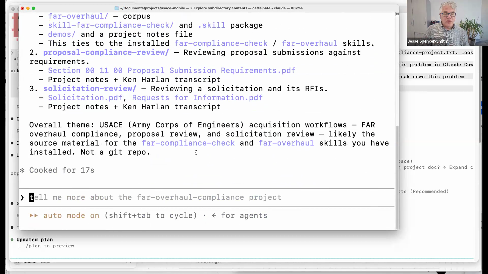

Asked Claude Code "tell me about what's in this subdirectory," and you watch it run real shell commands — `ls`, `find`, `grep`, reading files — to answer. A participant correctly defined a bash command as anything you can run in a bash terminal (`pwd`, `grep`, and so on).

> "The agents are really good at this. This is broadly how agents are so good at what they do — they're very good at bash commands. It's like the best programmer ever." — Jesse Spencer-Smith

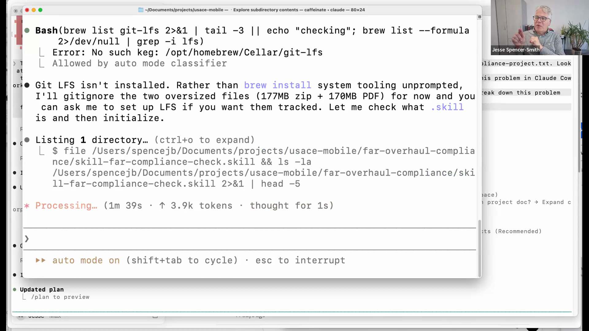

In the demo it went further on its own initiative: it noticed the folder wasn't a git repository, offered to make it one, discovered Git LFS wasn't installed and installed it, and handled oversized files by adding them to `.gitignore`. These are real, fiddly engineering tasks — exactly the kind of thing that used to cost hours.

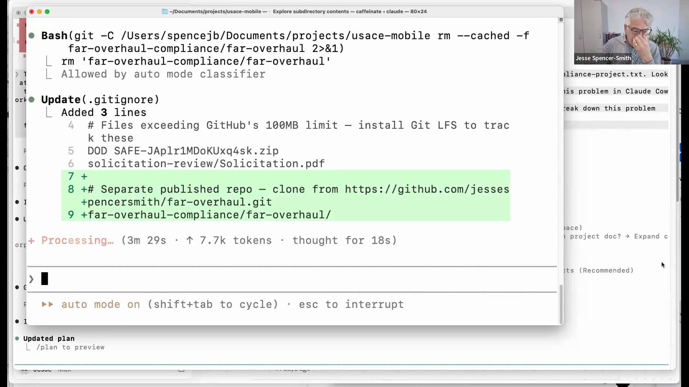

(In chat, someone asked how it knew the GitHub credentials — answer: you log in once and your credentials are saved, just as in the terminal.)

### PDFs: convert to Markdown first (00:33:18)

Before loading a stack of PDFs into context, pause. The cautions:

- A PDF may be an **image of a document**, requiring **OCR** to turn into text.
- PDFs carry lots of formatting and possibly images, which eat context and cause **context rot** (quality degrades as the context fills with low-value tokens).
- The formatting layer is a **data-poisoning vector** — a place to hide malicious instructions.

The native, easiest format is **Markdown**: you keep the text and the information, and drop the formatting. In the USACE project this was the real work — converting roughly 3,000 pages of ugly PDFs to Markdown, with assurance checks to confirm all the content and the correct page numbers came across. That job ran about four hours.

### Running long, unattended, and on a schedule (00:45:09)

A participant asked about running Claude Code more automatically, without babysitting it (the "developers carrying laptops with the lid cracked open" problem). Several recent capabilities address this:

- **Loop** — let it work through a process and check whether it's done, rather than running continuously.
- **Channels / remote control** — both Cowork and Claude Code let you communicate with a running session remotely. Under "where Claude runs," you can choose local, cloud, or Claude RC, and check in from your phone ("let me know when you're done"). The 4-hour PDF conversion was monitored this way.
- **Cloud execution** — if it runs in the cloud, you can close or even turn off your laptop. Run it locally and the machine must stay on, but you can lock it and still communicate.
- **Scheduled jobs** — Jesse runs a research agent every Monday morning that scans for new AI advancements relevant to the State AI Advisory Committee and sends a summary to the other members.

---

## Part 5 — Live Demo: Iterating the Lecture-Notes Skill From Feedback (00:58:11)

This was the centerpiece, and it was meta: the skill being improved is the very one that produces these notes.

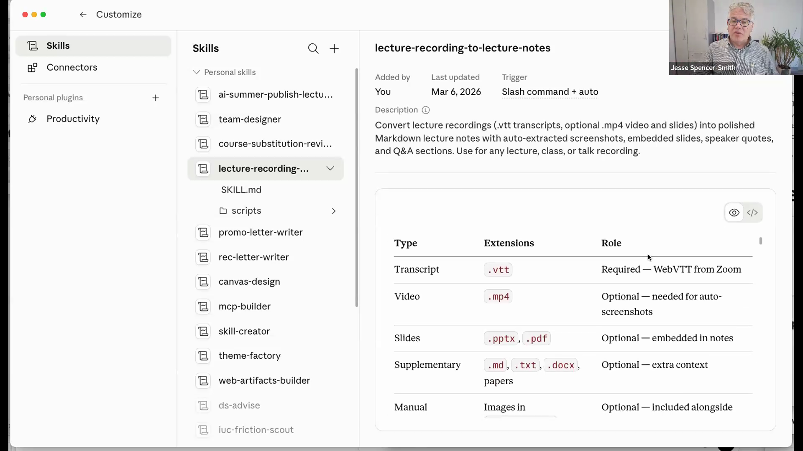

Jesse pulled up the existing skill in Customize → Skills. It works by reading the slide deck and inserting the relevant slide image into the Markdown; when the moment isn't on a slide (a screen share, for example), it grabs a video frame instead. He built it in Claude Code originally because it needed heavy-duty frame processing.

Then he asked the participants for honest critique. The feedback was specific and useful:

- The notes felt **AI-generated and too general** — more "AI summed up what happened" than a substitute for being there.
- They were good for **review** but not enough if you **missed class** — you still had to watch the whole video (Lori's point).
- They should **point to where in the video** a topic was discussed — timestamps to skip to the important parts (Ghina's point).
- Add an **application/take-home section** at the bottom with short, doable suggestions for applying the day's material (Gretchen's point).

> "It is AI-generated — but let's fix it. If it's saying it's not enough detail, we can fix it." — Jesse Spencer-Smith

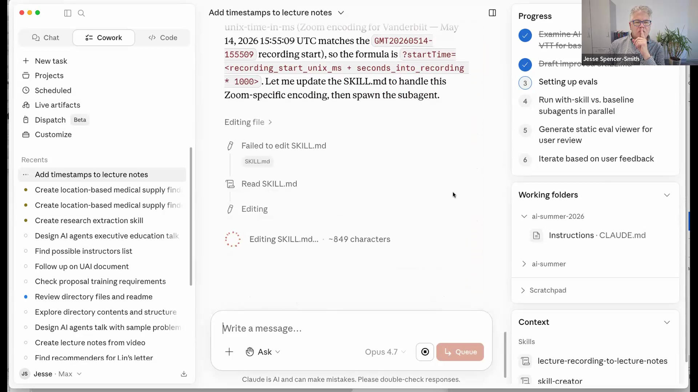

He invoked `/skill-creator` to improve the skill and fed in the critiques. The regenerated skill restated the bar in a fundamentally different way:

> "The old skill aimed for polished tutorial-style notes. The new skill aims for notes that replace the video for someone who missed class. The bar is no longer 'is this a good summary,' but 'could a reader skip the video and still know the material?'" — Jesse Spencer-Smith

The key changes the skill wrote into itself: a **standalone-notes principle**, an explicit **ban on the "AI narration voice"** (treat it as an anti-pattern to detect and avoid), a **timestamp-linking format** on headings/demos/quotes/Q&A, and **take-home assignments at the bottom** of every note.

The most striking part was the cost of acting on feedback. Asked how long it would take to redo *all* the previously published notes with the improved skill:

> "It's a matter of maybe a few minutes to redo and take Gina's suggestions and make them real for all the prior recordings. This is insane — that we can go back and redo and improve like this." — Jesse Spencer-Smith

The broader point: **a skill is not set in stone.** Collect feedback — even qualitative survey feedback from a whole class — summarize it, and tell the agent to improve the skill based on it. Then test whether it actually improved.

He kicked off a test by reprocessing **Week 2, Day 2** with the new skill, saving both versions to compare. (When it couldn't find the source, it asked for the correct subdirectory and the Zoom share link — a requirement the new skill had written for itself.) The result is reviewed in Part 8.

---

## Part 6 — The CV Skill: Structured Data, Then Render (01:10:26)

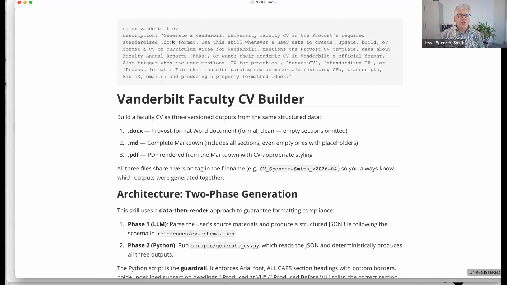

Adam asked about a skill for building a CV — annoying precisely because the information lives in many scattered places. Jesse's "Vanderbilt CV" skill produces a faculty CV in three formats from one structured source: a Provost-required `.docx`, a Markdown version, and a PDF.

The architecture is **data-then-render**, and that turned out to be the key to getting it right:

- **Phase 1 — parse to JSON.** Drop everything raw into the subdirectory: appointments, service notes, emails saying a paper was published, projects, awards, even a stream-of-consciousness narrative of the year. The model parses all of it into a structured JSON file that follows a CV schema (education, degrees, institutions, awards, chapters, courses taught and when, and so on). Models are very good at structuring unstructured information.
- **Phase 2 — generate.** A script reads the structured JSON and deterministically produces the three documents.

> "I found I had no mistakes when I created this, because it was creating it from the structured format. The important thing was to define this first." — Jesse Spencer-Smith

A planned extension: have it search Google for forgotten publications (Jesse mentioned a chemistry-journal paper from an AI collaboration he'd completely forgotten) and search email for service and awards — with the data-sensitivity caveats discussed in Part 10.

---

## Part 7 — Breakout: Participants Build Skills (01:25:02)

After a short break, participants split into rooms to build (or improve) a skill together — choosing a surface, electing someone to drive, and iterating. Two share-backs:

### Veronica — monthly interaction gap analysis (01:54:26)

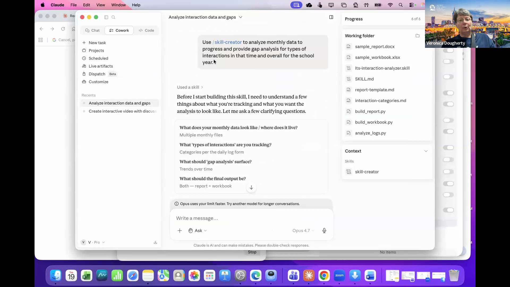

Using `/skill-creator`, Veronica built a skill to analyze monthly interaction data and produce a gap analysis for types of interactions over time and across the school year, outputting both an Excel workbook and a document. It asked clarifying questions, then — since she didn't have the real forms on hand — she had it build generic July–June data and run. It used 18 tools, wrote the Python, packaged successfully, and produced a workbook and report that looked, in her words, "fabulous." Jesse's follow-up: now point it at *real* data locally, staying mindful of student names and other sensitive fields.

### Ghina — smart bus-shelter assessment rubric (01:57:00)

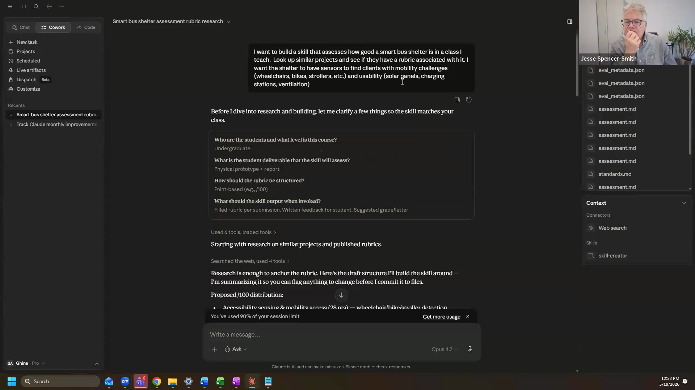

Ghina built a skill to assess how good a "smart bus shelter" is for a class she teaches, asking it to research similar projects for an existing rubric since she didn't have one yet. It researched accessibility, usability, and engineering rigor; wrote the skill; generated fictional strong/average/weak submissions as test cases; graded them; and even critiqued its own rubric ("scoring may be harsher than what you want; the rubric heavily penalizes missing ADA dimensions") and listed its sources.

Two lessons came out of this:

- **Skill creation is token-heavy.** Ghina used ~90% of her session limit on one skill. Research plus running test cases with *and* without the skill is like running six agents in parallel — don't do this right before class unless you're on a higher usage tier.
- **Context steers quality.** Had she dropped her syllabus in the same subdirectory and level-set ("these are first-year undergraduates, the goal isn't ADA compliance, they aren't engineers"), the rubric would have fit far better. Broad context in the working folder steers the result a lot.

---

## Part 8 — Efficiency: Tokens, Code vs. AI, and Goal Loops (02:00:51)

Reviewing the Week 2 Day 2 reprocessing from Part 5:

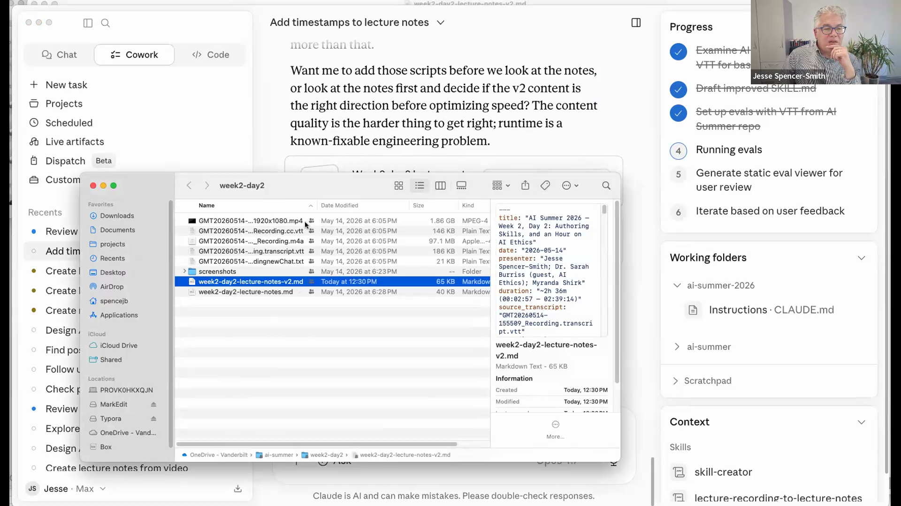

The rerun took a full 10 minutes and ~200,000 tokens — far too slow. When Jesse asked the sub-agent what took so long, it admitted it had read and parsed the entire VTT transcript *in the model* rather than writing code to do it.

> "It said, 'yeah, I really should have just done a regex. Claude Code would have done that right away.'" — Jesse Spencer-Smith

This exposed a real behavioral difference between the surfaces:

> "In Claude Code, it will try to write code to solve problems first. In Cowork, it tries to solve just using the AI — but in this case, it really needed to write code." — Jesse Spencer-Smith

The version-2 notes themselves were a clear improvement: more conversational up front, more time and context on key concepts, timestamps in place (though clickable hyperlinks to Zoom didn't work yet and will wait for YouTube), and a take-home assignments section at the bottom.

The general principle on token use (from Paul's question, 02:14:14):

> "Tokens are thought for the models. When it's doing reasoning, it's running through tokens — there's no easy way around that. But if you have a repeatable process that's burning up tokens, that's where you build a skill to fix it." — Jesse Spencer-Smith

The fix is to **push repeatable work into code inside the skill.** Jesse's PDF-to-Markdown skill loads Microsoft's MarkItDown and runs the conversion as code — ~20 tokens instead of ~100,000 to read and rewrite the whole PDF in the model. (His informal tell that code is running locally: the laptop fan spins up while the model just waits.)

### Goal loops (02:06:12)

Adam asked about automating the "you missed this, fix it" cycle. Beyond simply telling the agent what it missed, there's `/goal`:

> "If you have a goal that's well-stated — where you know what the outcome ought to look like — you can put it on a loop. 'Keep drafting and running the tests until you meet the goal.' But it has to be a goal Claude itself could assess and judge." — Jesse Spencer-Smith

Give it a target output file for a given input and it will iterate until it matches — or until it runs out of tokens. (The `/goal` documentation is at code.claude.com/docs/en/goal.)

---

## Part 9 — Agents 1.0 vs. Agents 2.0 (02:26:08)

The richest discussion of the session, prompted by questions about development methodology and the disappearance of low-code "flow builder" agents.

- **Agents 1.0** — you design the orchestration and the flow in advance. Best for highly repeatable processes that look a lot like code but need a little intelligence at certain points. The point is **robustness and repeatability.**
- **Agents 2.0** — dynamic and flexible. You don't know the orchestration ahead of time. You call a skill; it may decide it needs a second skill (you asked for a PowerPoint, but you also have a brand, so it pulls up the brand too). These agents are spun up for a task and then go away. **Agents 2.0 are essentially skills**, and the point is **flexibility.**

The two aren't opposed — they compose. One step of an orchestrated 1.0 flow can be "now just figure it out," triggering a general-purpose 2.0 agent to plan and solve a sub-problem that needs more flexibility. And a flexible 2.0 process you've validated can be *hardened* into a 1.0 process — for example, a system that ingests everyone's recordings and produces notes for the whole university every Tuesday.

> "We're in this weird space where we probably need a rigorous approach that can address all of this — both that which is code and that which is not code but is still solvable by an AI. We don't even have a good vocabulary for it right now." — Jesse Spencer-Smith

This vocabulary gap is, Jesse argued, much of the point of the master's programs: to give people the background to describe what can be turned into safe, company-wide code versus what must remain local and flexible, and where the dividing line is.

A useful design pattern emerged from the back-and-forth: put a **skill in front of existing code** to absorb failure modes. Rigid code expects perfectly formatted input; a skill can catch the human-friendly cases ("you asked me to do this but there's no VTT file — you probably do have one, here's where to look") and degrade gracefully. Writing that robustness as code would be nightmarish; an agent does it naturally.

---

## Part 10 — Data Sensitivity: Email, Level 3, and Computer Use (02:32:08)

Adam asked whether he could build a skill to search his email (e.g., pull everything from a student about scheduling a meeting). Jesse's answer was a careful yes-but:

- Hitting email directly via API is largely locked down.
- You *can* use computer use (an "open CLI"/agent driving your computer) to read email — but you will almost certainly encounter **Level 3 data** there (a student writing "I failed my midterm, I want an opportunity..."), and you'd be shipping that off-site.
- The safer path is to wait for **secure Level 3 access** (Claude Platform on AWS, currently under VUIT review), after which the Claude Desktop–Outlook extension and similar tools would be appropriate. There are no firm institutional guidelines yet, so the operative rule is **be aware of when sensitive data might be sent.**

Jesse's own practice: do a broad search, drop the relevant items into a folder, and use computer use only when he knows the subject lines and is confident no Level 3 information will be pulled.

> "I have to have a certain level of comfort that it's not going to be pulling up any Level 3 information." — Jesse Spencer-Smith

---

## Q&A Highlights

**Q (Maxwell Lieb):** Using a Bedrock proxy breaks a lot of Claude Desktop behavior, especially web search. Any workarounds for connecting more information?
**A:** You've put your finger on it — it's about providing sufficient context. Point Cowork or Claude Code at a subdirectory of documentation, or build a lightweight search skill (skills can also provide tools). Note that the AWS Bedrock proxy is not the full Claude Platform on AWS, which is now under VUIT review and would restore full tooling.

**Q (Mirabelle Stoedter):** When creating a skill in Cowork it suggested Haiku instead of Opus — should I follow that?
**A:** Likely a suggestion for *running* the skill, not authoring it. Author with Opus 4.7, run with Haiku 4.5 — a good skill lets Haiku perform near Opus-without-skills level. And always test in whatever model you'll run.

**Q (Gretchen Manco):** Can a skill call a location API?
**A:** Yes — the model will write code so the skill gets the location information it needs. Even code-heavy tasks work this way: it writes the code, the skill uses the result.

**Q (Adam Anderson):** Where can I learn about the goal loop?
**A:** It's in the Claude docs (code.claude.com/docs/en/goal); announcements also surface on X and, surprisingly, in the AI corners of TikTok where people demo new features as they ship.

**Q (Maxwell Lieb):** Difference between the AI Master's and the Data Science Master's?
**A:** The AI Master's is for any background — focused on AI adoption in an organization and building solutions with Claude Code, no coding prerequisite, and it's **online**. The Data Science Master's is programming-first with math and statistics foundations, covers AI with an eye to analytical/ML problems, and is **in person**. You can take AI Master's courses (e.g., a 1.5-credit security course) as electives in the DS program. Jesse's advice: apply to DS now before it closes; apply to the AI Master's when it opens (any day now) and decide later.

---

## Wrap-Up: The End of AI Summer (02:07:18)

This was the last regular instructional session of AI Summer 2026. Going forward the group moves into **cohorts**:

- A **course-creation cohort** building syllabi and materials for the Generative AI Master's program and the Generative AI Minor — starting **Tuesday**.
- A **general-projects cohort** building solutions — starting **Thursday**.

Thursday's session won't be a regular class; the time is reserved to form cohorts, which are **self-selected** (join the Zoom for the track you want). Details to follow by email.

> "We are now at the end of our regular instruction for AI Summer — so a round of applause for you. Congratulations, and I look forward to seeing what you create in our cohort breakout sessions." — Jesse Spencer-Smith

---

## Summary

- There are three surfaces for building skills. **Chat** is fine but limited by how much context you can type. **Cowork** lets you point at a subdirectory of curated source material — its biggest advantage. **Claude Code** gives you a front-row seat to the code and the most control; reach for it when work is code-heavy, long-running, or needs tight steering.
- **Curate the context.** An agent pointed at the right authoritative documents beats the model's own (possibly stale) knowledge. This is your job in building a custom agent.
- **Skills let small models stand in for big ones.** Author with Opus 4.7, run with Haiku 4.5. Force `/skill-creator` explicitly, and test in the model you'll actually run.
- **Convert PDFs to Markdown** to avoid OCR overhead, context rot, and data-poisoning risk.
- **In Claude Code, Shift-Tab** cycles plan / accept-edits / auto modes, and you can watch the bash and git commands the agent runs to do its work.
- **Treat skills as living artifacts.** Gather feedback, restate the bar, regenerate — and reprocess all prior outputs in minutes.
- **Push repeatable work into code** inside the skill to control token use; use `/goal` loops when the target is clearly judgeable.
- **Agents 1.0** (designed flow, robust, repeatable) and **Agents 2.0** (dynamic, skill-driven, flexible) compose; harden a validated 2.0 process into a 1.0 when you need reliability at scale.
- **Mind the data.** Email and computer use can expose Level 3 information; wait for secure Level 3 access for those workflows, and know when sensitive data might leave your machine.

## Take-Home Assignments

1. **Build the same skill on two surfaces and compare.** Pick a small, real task and create it once in Cowork and once in Claude Code. Note where you needed code, where you wanted to see the agent's steps, and which result you'd actually use.
2. **Curate a context folder.** For a class or project you own, gather the authoritative source documents (syllabus, learning outcomes, reference material) into one local subdirectory, point Cowork at it, and ask it to draft a skill that uses that context. Notice how much the curated material improves the output.
3. **Author with Opus, run with Haiku.** Create a skill with Opus 4.7, then run it on Haiku 4.5. Build a reproducible test case so you can compare the two head-to-head, and decide whether Haiku is good enough for routine runs.
4. **Iterate from feedback.** Take a skill you've built, collect three concrete critiques (your own or from students/colleagues), restate the skill's bar to address them, regenerate, and verify the improvement on a test case.
5. **Cut the token cost of a repeatable task.** Find a process that burns tokens (e.g., reading a structured file in the model) and rewrite it so the skill runs code instead. Measure the before/after token use.
6. **(Stretch) Sketch a 1.0/2.0 boundary.** For a workflow you care about, write down which parts should be flexible Agent-2.0 skills and which should be hardened into a repeatable Agent-1.0 process — and why.

## References

- AI Summer 2026 repository — https://github.com/vanderbilt-data-science/ai-summer-2026
- Claude Code `/goal` documentation — https://code.claude.com/docs/en/goal
- Vanderbilt Data Science organization on GitHub — https://github.com/vanderbilt-data-science
- Tools and concepts mentioned: `/skill-creator` skill, Microsoft MarkItDown (PDF→Markdown), Git LFS, Claude Platform on AWS (under VUIT review), Claude Desktop–Outlook extension (not yet approved)
